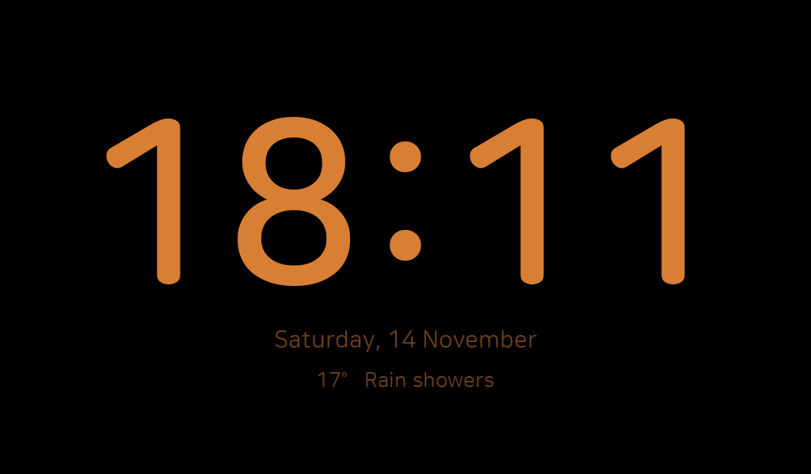
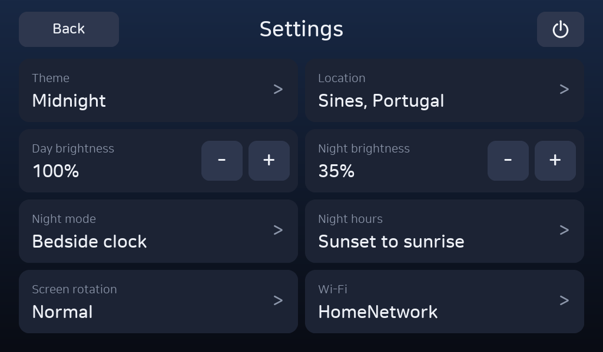
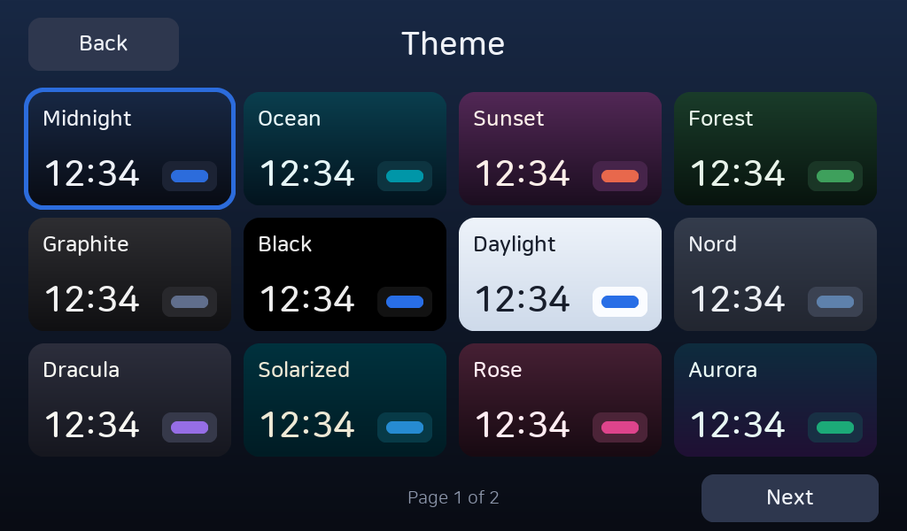
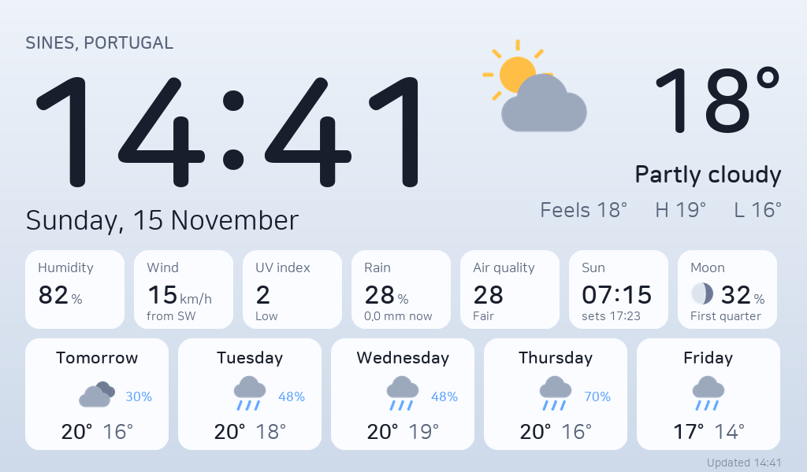

# Sonic Pad Weather Clock

Turns a Creality Sonic Pad (running Debian 11) into a standalone touchscreen
clock and weather station. It boots straight into a fullscreen dashboard, needs
no keyboard, mouse or desktop, and everything can be changed from the touchscreen.


## Features

- Large 24-hour clock, date and place name
- Current weather: temperature, feels-like, high/low, condition and icon
- Humidity, wind speed and direction, UV index, rain chance and rainfall
- Air quality (European AQI), sunrise and sunset, moon phase
- Five-day forecast
- UV and air quality tiles turn orange when levels are high
- Bedside night mode: a dark amber clock between sunset and sunrise (or fixed hours)
- 16 themes: Midnight, Ocean, Sunset, Forest, Graphite, Black, Daylight, Nord,
  Dracula, Solarized, Rose, Aurora, Amber, Terminal, Paper, Sky
- Touchscreen settings: theme, location search, day/night brightness, night mode,
  night hours, screen rotation, Wi-Fi networks and passwords
- Keeps working through network drops (shows the last weather and retries)
- Plain Python 3 + Pillow drawing straight to the framebuffer: no X server,
  no desktop and no extra packages

| Bedside night mode | Settings | Themes |
|---|---|---|
|  |  |  |

| Daylight theme | Wi-Fi | Location search |
|---|---|---|
|  |  |  |

## Using it

| Do this | To |
|---|---|
| Hold a finger on the screen for 2 seconds, then let go | Open **Settings** |
| Tap the screen at night | Show the full dashboard for 30 seconds (the first tap only wakes it) |
| Tap "Wi-Fi settings" (shown only when offline) | Go straight to the Wi-Fi list |

Settings screens return to the clock after 3 minutes without a touch.

**Changing Wi-Fi:** Settings → Wi-Fi → tap a network → type the password → Connect.
The network is saved and rejoined automatically after reboots. Tap a saved network
to reconnect, change its password or forget it.

**Changing location:** Settings → Location → type a town (English or Portuguese
names both work) → Search → pick the right place. Weather, sunrise/sunset and
the clock's time zone switch to that place.

## Requirements

- Creality Sonic Pad already running **Debian 11** with SSH access, installed with
  [Jpe230/SonicPad-Debian](https://github.com/Jpe230/SonicPad-Debian). Follow that
  project's instructions to flash the Pad; this project starts from there
- The Pad on Wi-Fi with internet access
- A computer with `ssh` and `scp` (built into Windows 10/11, macOS and Linux)

Nothing needs installing on the Pad: it already has Python 3.9, Pillow,
NetworkManager and the fonts used.

## First-time setup

1. **Find the Pad's IP address** (from your router, or run `ip -brief addr` on the Pad).

2. **Optional: check the hardware first.** This read-only script collects display,
   backlight, touch, network and Python details into `/tmp/sonicpad-diag.txt`:

   ```bash
   scp tools/sonicpad-diagnose.sh sonic@<pad-ip>:/tmp/
   ssh -t sonic@<pad-ip> "sudo bash /tmp/sonicpad-diagnose.sh"
   ```

3. **Install.** From this repository folder:

   Windows (PowerShell):
   ```powershell
   .\scripts\deploy.ps1 -PadHost <pad-ip>
   ```
   Linux / macOS:
   ```bash
   ./scripts/deploy.sh <pad-ip>
   ```

   Type the Pad's password when asked (it asks several times: copy, login, sudo).
   The installer:
   - copies the app to `/opt/weatherclock/`
   - installs and enables `weatherclock.service` (starts at boot, restarts if it crashes)
   - **disables Creality's `display-sleep.service`**, which otherwise turns the
     backlight off a few seconds after boot (see [docs/hardware.md](docs/hardware.md))

   The clock appears on the screen within a few seconds.

4. **Secure the Pad.** The default login is well known. Change it:

   ```bash
   ssh sonic@<pad-ip> passwd
   ```

   To stop typing the password on every deploy, add an SSH key
   (Windows PowerShell shown; on Linux/macOS use `ssh-copy-id sonic@<pad-ip>`):

   ```powershell
   ssh-keygen -t ed25519
   type $env:USERPROFILE\.ssh\id_ed25519.pub | ssh sonic@<pad-ip> "mkdir -p ~/.ssh && cat >> ~/.ssh/authorized_keys"
   ```

## Updating

Edit the code, then run the same deploy command again. Your settings in
`/opt/weatherclock/settings.json` are kept.

Add `-Screenshots` (Windows) or `--screenshots` (Linux/macOS) to re-render every
screen and theme on the Pad into `docs/screenshots/`.

## Configuration

Everything normally changes from the touchscreen. Settings are stored on the Pad in
`/opt/weatherclock/settings.json`:

| Key | Default | Meaning |
|---|---|---|
| `theme` | `Midnight` | Any theme name from the list above, e.g. `Nord` or `Paper` |
| `place`, `lat`, `lon`, `tz` | Sines, Portugal | Location shown and used for weather |
| `day_bright` / `night_bright` | `100` / `35` | Backlight level, 0–100 |
| `night_mode` | `bedside` | `bedside`, `dim` (dashboard at night brightness) or `off` |
| `night_hours` | `sun` | `sun` (sunset to sunrise), `22` or `23` (until 07:00) |
| `rotate` | `0` | `0` or `180` (upside down) |

If you edit the file by hand, restart the clock: `sudo systemctl restart weatherclock`.

If taps land in the wrong place on a different panel, add one of these lines under
`[Service]` in `/etc/systemd/system/weatherclock.service`, then run
`sudo systemctl daemon-reload && sudo systemctl restart weatherclock`:

```ini
Environment=CLOCK_TOUCH_SWAP_XY=1
Environment=CLOCK_TOUCH_INVERT_X=1
Environment=CLOCK_TOUCH_INVERT_Y=1
```

## Troubleshooting

| Problem | What to do |
|---|---|
| Screen black after boot | `systemctl status weatherclock display-sleep`: the clock should be active and display-sleep disabled. Reinstall with the deploy script. |
| "Waiting for weather..." | Normal for the first seconds after boot while Wi-Fi connects. If it stays, open Settings → Wi-Fi. |
| "Offline" at the bottom | The last weather is still shown; it retries every minute. Check Wi-Fi. |
| Taps hit the wrong place | See the touch options under Configuration. Every tap is logged with its position. |
| See what the clock is doing | `sudo journalctl -u weatherclock -f` |

## Uninstall

After a deploy the scripts are in `/tmp/weatherclock` on the Pad:

```bash
ssh -t sonic@<pad-ip> "sudo bash /tmp/weatherclock/uninstall.sh"
```

This removes the service, the app and its settings. It does not re-enable
`display-sleep` (that would turn the screen off again); the script explains how
if you want it.

## Project layout

```
weatherclock/
  weatherclock.py        the app (dashboard, bedside clock, settings, Wi-Fi, keyboard)
  weatherclock.service   systemd unit
  install.sh             installs on the Pad (run by the deploy scripts)
  uninstall.sh           removes it from the Pad
scripts/
  deploy.ps1             deploy from Windows
  deploy.sh              deploy from Linux / macOS
tools/
  sonicpad-diagnose.sh   read-only hardware report
docs/
  hardware.md            what was found about the Sonic Pad's display, touch and Wi-Fi
  screenshots/           rendered on the Pad with --preview-ui
```

Run `python3 weatherclock.py --preview-ui <folder>` on the Pad to render every
screen to PNG files without touching the display.

## Credits

Debian on the Sonic Pad comes from [Jpe230/SonicPad-Debian](https://github.com/Jpe230/SonicPad-Debian).

Weather, air quality and place search data by [Open-Meteo.com](https://open-meteo.com/),
licensed under [CC BY 4.0](https://creativecommons.org/licenses/by/4.0/). Open-Meteo's
free API is for non-commercial use.

## License

MIT. See [LICENSE](LICENSE).
