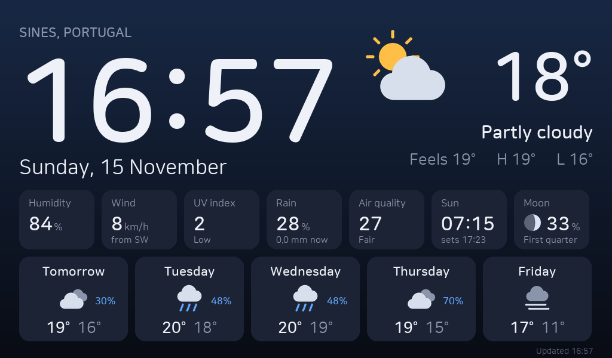
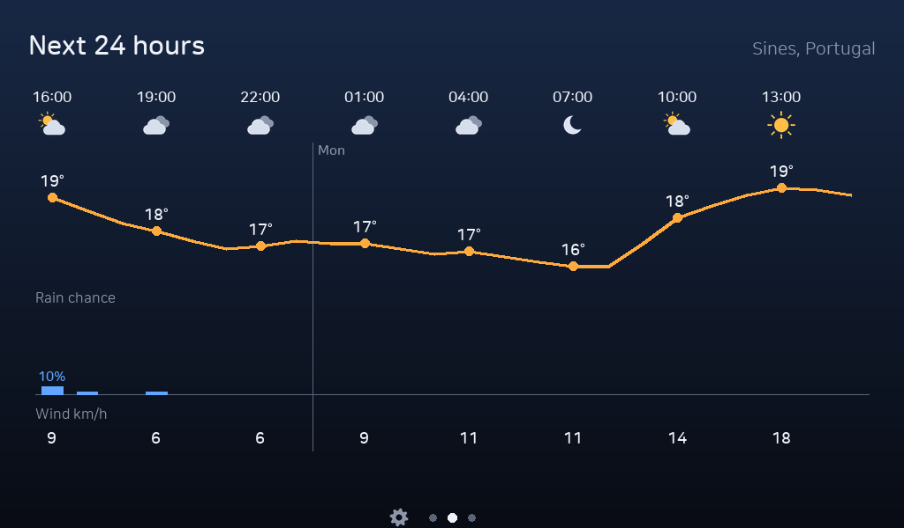
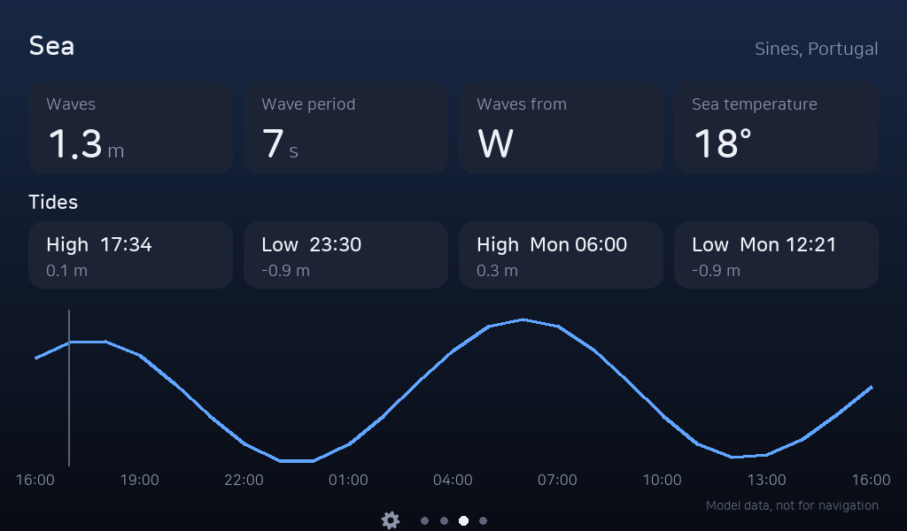
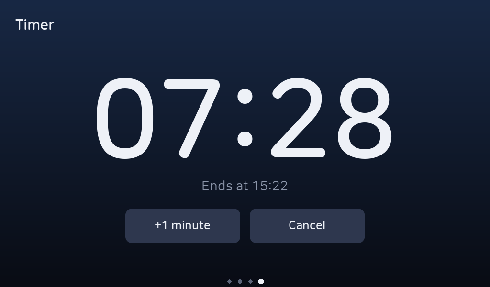
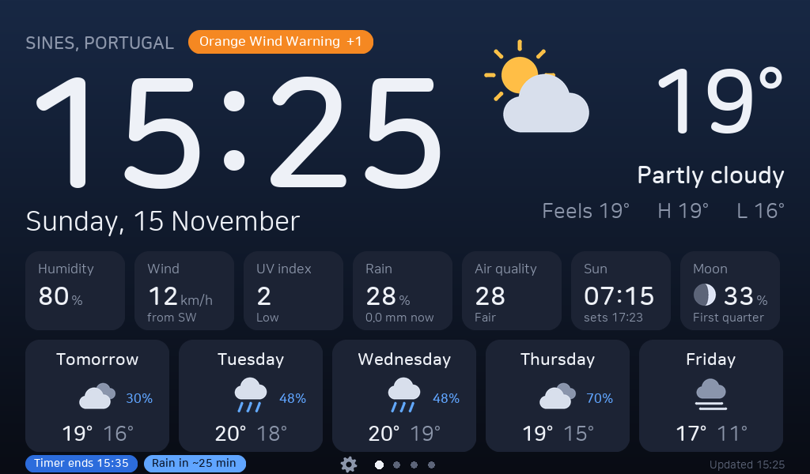
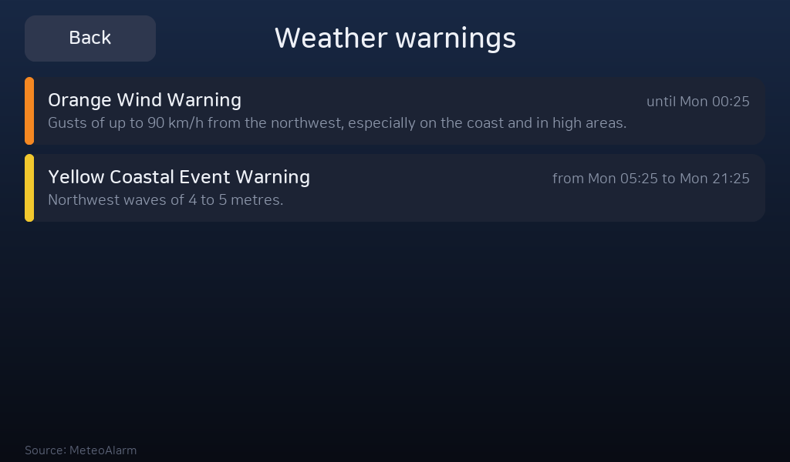
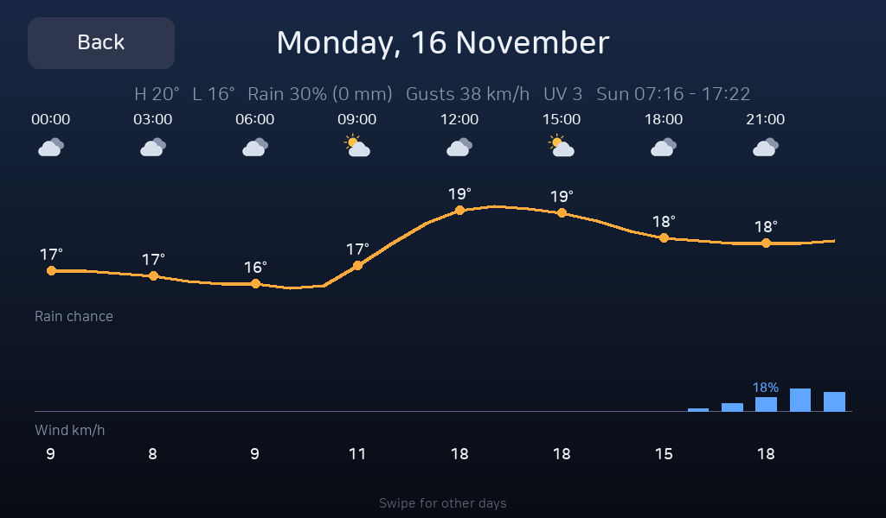
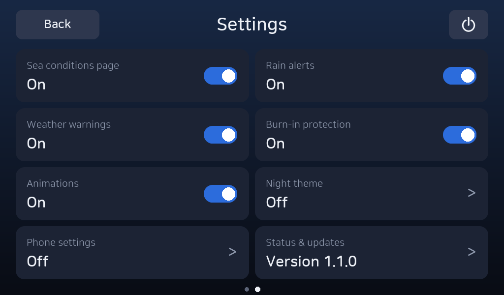
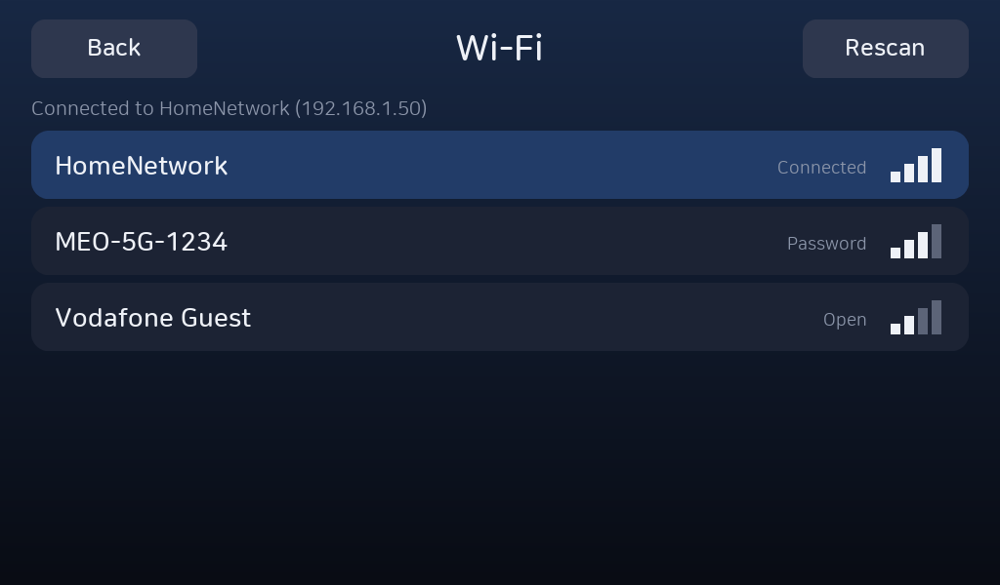
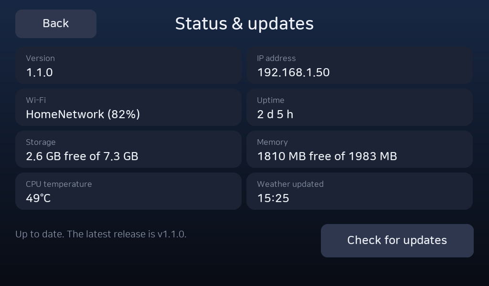

# Sonic Clock

Turns a Creality Sonic Pad (running Debian 11) into a standalone touchscreen
clock and weather station. It boots straight into a fullscreen dashboard, needs
no keyboard, mouse or desktop, and everything can be changed from the touchscreen.



## Features

- Large 24-hour clock, date and place name
- Current weather: temperature, feels-like, high/low, condition and icon
- Humidity, wind speed and direction, UV index, rain chance and rainfall
- Air quality (European AQI), sunrise and sunset, moon phase
- Five-day forecast; tap a day for its hour-by-hour detail
- Swipe pages: next 24 hours (temperature, rain chance, wind), sea conditions, timers
- **Weather warnings worldwide:** official warnings from
  [MeteoAlarm](https://meteoalarm.org/) in 38 European countries and the US National
  Weather Service in the US; elsewhere, alerts worked out from the forecast
  (wind, heavy rain, snow, heat, cold, thunderstorms)
- Rain alerts: "Rain in ~25 min" from 15-minute forecasts
- Sea conditions (optional): waves, sea temperature, high and low tides
- Kitchen timers: 5, 10, 15 and 25 minutes; the screen flashes when time is up
- UV and air quality tiles turn orange when levels are high
- Bedside night mode: a dark amber clock between sunset and sunrise (or fixed hours)
- Screen off schedule (optional): between two times you choose, the screen goes dark
  10 seconds after the last touch; touch it to see the clock again
- 24 themes, plus an optional separate night theme: Midnight, Ocean, Sunset, Forest,
  Graphite, Black, Daylight, Nord, Dracula, Solarized, Rose, Aurora, Amber, Terminal, Paper, Sky,
  Lavender, Coffee, Ember, Indigo, Olive, Copper, Mint and Contrast (high contrast, for reading
  from across the room)
- Animations (can be turned off): the weather icon moves (turning sun, drifting
  clouds, falling rain and snow, flashing thunder, twinkling stars) and pages slide
  when you swipe. Only the icon's corner of the screen is redrawn, so it costs about
  5% of one CPU core; animations pause in bedside mode
- Burn-in protection: the picture shifts a few pixels every 10 minutes
- Touchscreen settings: theme, location search, day/night brightness, night mode,
  night hours, screen rotation, Wi-Fi networks and passwords, feature switches
- Optional phone settings page on your home network, protected by a PIN
- Status screen and one-tap updates from this repository's GitHub Releases
- Keeps working through network drops (shows the last weather and retries)
- Plain Python 3 + Pillow drawing straight to the framebuffer: no X server,
  no desktop and no extra packages

| Next 24 hours | Sea | Timer |
|---|---|---|
|  |  |  |

| Warning on the dashboard | Warning details | Day detail |
|---|---|---|
|  |  |  |

| Bedside night mode | Settings | More settings |
|---|---|---|
|  |  |  |

| Themes | Wi-Fi | Status & updates |
|---|---|---|
|  |  |  |

## Using it

| Do this | To |
|---|---|
| Swipe right on the dashboard, or tap the gear next to the page dots | Open **Settings** (tap **More** or swipe for pages 2 and 3) |
| Hold a finger on the screen for 2 seconds, then let go | Also opens Settings, from any page |
| Swipe left or right | Switch between the dashboard, next 24 hours, sea and timer pages |
| Tap a forecast day | See that day hour by hour (swipe for other days) |
| Tap the detail tiles | Open the next 24 hours |
| Tap a warning, rain or timer badge | Open the warning details, the hours or the timer |
| Tap the screen at night | Show the full dashboard for 30 seconds (the first tap only wakes it) |
| Tap the dark screen (screen off schedule) | Turn it on; it goes dark again 10 seconds after the last touch (the first tap only wakes it) |
| Settings → page 3 | Turn the screen off schedule on or off and set its times (half-hour steps) |
| Tap "Wi-Fi settings" (shown only when offline) | Go straight to the Wi-Fi list |
| Settings → Power → Shut down or Restart | Turn the clock off or restart it safely |

Settings screens and swipe pages return to the dashboard after 3 minutes without a
touch (a running timer page stays).

**Weather warnings:** a yellow, orange or red badge appears next to the place name.
Official warnings are matched to your region (e.g. "Setúbal") by name, so pick your
location with the in-app search. Where no official source is available, the badge
shows alerts worked out from the forecast, and the details page says so.

**Phone settings:** Settings → More → Phone settings turns on a small web page on
port 8080. The clock shows its address and a 4-digit PIN; open it on a phone on the
same Wi-Fi. It is off by default, works only on your home network, gets a new PIN
every time it is turned on, and locks for a minute after 5 wrong PINs.

> [!WARNING]
> **Don't turn it off with the side button or by pulling the plug.** Debian on the
> Pad uses a read/write filesystem, so cutting the power can damage files. Use
> Settings → Power → Shut down, wait 30 seconds, then unplug. Over SSH:
> `ssh sonic@<pad-ip> sudo poweroff`.

**Changing Wi-Fi:** Settings → Wi-Fi → tap a network → type the password → Connect.
The network is saved and rejoined automatically after reboots. Tap a saved network
to reconnect, change its password or forget it.

**Changing location:** Settings → Location → type a town (English or Portuguese
names both work) → Search → pick the right place. Weather, sunrise/sunset and
the clock's time zone switch to that place.

## Requirements

- Creality Sonic Pad already running **Debian 11** with SSH access, installed with
  [Jpe230/SonicPad-Debian](https://github.com/Jpe230/SonicPad-Debian). Follow that
  project's instructions to flash the Pad; this project starts from there
- The Pad on Wi-Fi with internet access
- A computer with `ssh` and `scp` (built into Windows 10/11, macOS and Linux)

Nothing needs installing on the Pad: it already has Python 3.9, Pillow,
NetworkManager and the fonts used.

> [!CAUTION]
> Replacing the Pad's firmware will most likely void its warranty. Neither this
> project nor SonicPad-Debian is endorsed by Creality. Read the
> [SonicPad-Debian disclaimers](https://github.com/Jpe230/SonicPad-Debian#-disclaimers)
> before flashing. You do this at your own risk.

## First-time setup

1. **Find the Pad's IP address** (from your router, or run `ip -brief addr` on the Pad).

2. **Optional: check the hardware first.** This read-only script collects display,
   backlight, touch, network and Python details into `/tmp/sonicpad-diag.txt`:

   ```bash
   scp tools/sonicpad-diagnose.sh sonic@<pad-ip>:/tmp/
   ssh -t sonic@<pad-ip> "sudo bash /tmp/sonicpad-diagnose.sh"
   ```

3. **Install.** From this repository folder:

   Windows (PowerShell):
   ```powershell
   .\scripts\deploy.ps1 -PadHost <pad-ip>
   ```
   Linux / macOS:
   ```bash
   ./scripts/deploy.sh <pad-ip>
   ```

   Type the Pad's password when asked (it asks several times: copy, login, sudo).
   The installer:
   - copies the app to `/opt/weatherclock/`
   - installs and enables `weatherclock.service` (starts at boot, restarts if it crashes)
   - **disables Creality's `display-sleep.service`**, which otherwise turns the
     backlight off a few seconds after boot (see [docs/hardware.md](docs/hardware.md))

   The clock appears on the screen within a few seconds.

4. **Secure the Pad.** The default login is well known. Change it:

   ```bash
   ssh sonic@<pad-ip> passwd
   ```

   To stop typing the password on every deploy, add an SSH key
   (Windows PowerShell shown; on Linux/macOS use `ssh-copy-id sonic@<pad-ip>`):

   ```powershell
   ssh-keygen -t ed25519
   type $env:USERPROFILE\.ssh\id_ed25519.pub | ssh sonic@<pad-ip> "mkdir -p ~/.ssh && cat >> ~/.ssh/authorized_keys"
   ```

## Updating

Edit the code, then run the same deploy command again. Your settings in
`/opt/weatherclock/settings.json` are kept.

Add `-Screenshots` (Windows) or `--screenshots` (Linux/macOS) to re-render every
screen and theme on the Pad into `docs/screenshots/`.

### Updating from the clock (GitHub Releases)

Settings → More → Status & updates → **Check for updates** installs the newest
[GitHub Release](../../releases) of this repository. Pads only ever get versions
published as a Release, never unfinished work on `main`.

To publish a new version:

1. Set `VERSION` near the top of `weatherclock/weatherclock.py` (e.g. `"1.2.0"`) and push.
2. Create a GitHub Release with the matching tag (`v1.2.0`).

The clock downloads that release, checks the code compiles, keeps a backup of the
old version as `weatherclock.py.bak`, installs it and restarts.

### Tests

The tests run on any computer with Python 3.9 or newer and Pillow; they need no Pad,
screen or network:

```bash
python3 -m unittest discover -s tests -t tests
```

They check the weather and warning logic, the screen-off and night hours, touch
mapping, settings validation, the phone settings page, the updater, and that every
screen still renders. GitHub runs them on every push and pull request, once with
Python 3.9 and Pillow 8.1.2 (what the Pad has) and once with current versions. Run
them before publishing a Release.

## Configuration

Everything normally changes from the touchscreen. Settings are stored on the Pad in
`/opt/weatherclock/settings.json`:

| Key | Default | Meaning |
|---|---|---|
| `theme` | `Midnight` | Any theme name from the list above, e.g. `Nord` or `Paper` |
| `place`, `lat`, `lon`, `tz` | Sines, Portugal | Location shown and used for weather |
| `day_bright` / `night_bright` | `100` / `35` | Backlight level, 0–100 |
| `night_mode` | `bedside` | `bedside`, `dim` (dashboard at night brightness) or `off` |
| `night_hours` | `sun` | `sun` (sunset to sunrise), `22` or `23` (until 07:00) |
| `rotate` | `0` | `0` or `180` (upside down) |
| `screen_off` | `false` | `true` turns the screen off between `off_from` and `off_until` |
| `off_from` / `off_until` | `1380` / `420` | Minutes after midnight (23:00 / 07:00); the window may cross midnight |
| `cc`, `regions` | `PT`, Setúbal | Country code and region names used to match official warnings |
| `sea` | `false` | Sea conditions page |
| `rain_alerts` | `true` | "Rain in ~N min" badge |
| `warnings` | `true` | Weather warnings |
| `night_theme` | `""` (off) | Theme used during night hours |
| `pixel_shift` | `true` | Burn-in protection |
| `web` | `false` | Phone settings page |
| `animations` | `true` | Animated weather icon and sliding pages |

If you edit the file by hand, restart the clock: `sudo systemctl restart weatherclock`.

If taps land in the wrong place on a different panel, add one of these lines under
`[Service]` in `/etc/systemd/system/weatherclock.service`, then run
`sudo systemctl daemon-reload && sudo systemctl restart weatherclock`:

```ini
Environment=CLOCK_TOUCH_SWAP_XY=1
Environment=CLOCK_TOUCH_INVERT_X=1
Environment=CLOCK_TOUCH_INVERT_Y=1
```

## Troubleshooting

| Problem | What to do |
|---|---|
| Screen black after boot | `systemctl status weatherclock display-sleep`: the clock should be active and display-sleep disabled. Reinstall with the deploy script. |
| "Waiting for weather..." | Normal for the first seconds after boot while Wi-Fi connects. If it stays, open Settings → Wi-Fi. |
| "Offline" at the bottom | The last weather is still shown; it retries every minute. Check Wi-Fi. |
| Taps hit the wrong place | See the touch options under Configuration. Every tap is logged with its position. |
| See what the clock is doing | `sudo journalctl -u weatherclock -f` |

## Uninstall

After a deploy the scripts are in `/tmp/weatherclock` on the Pad:

```bash
ssh -t sonic@<pad-ip> "sudo bash /tmp/weatherclock/uninstall.sh"
```

This removes the service, the app and its settings. It does not re-enable
`display-sleep` (that would turn the screen off again); the script explains how
if you want it.

## How it works

The Pad has no desktop, so the app draws every screen itself: it paints a picture with
Pillow, copies it straight to the display (`/dev/fb0`) and reads finger positions from
the touch panel (`/dev/input/event2`) to turn them into taps and swipes. Weather is
fetched in the background every 10 minutes.

For a plain-language tour of the code, see [docs/how-it-works.md](docs/how-it-works.md).

## Project layout

```
weatherclock/
  weatherclock.py        the whole app: screens, weather, warnings, Wi-Fi, timers,
                         phone settings page and updater
  weatherclock.service   systemd unit
  install.sh             installs on the Pad (run by the deploy scripts)
  uninstall.sh           removes it from the Pad
scripts/
  deploy.ps1             deploy from Windows
  deploy.sh              deploy from Linux / macOS
tools/
  sonicpad-diagnose.sh   read-only hardware report
tests/                   unit and screen tests (python3 -m unittest discover -s tests -t tests)
.github/workflows/
  tests.yml              runs the tests on GitHub
docs/
  hardware.md            what was found about the Sonic Pad's display, touch and Wi-Fi
  how-it-works.md        plain-language tour of how the app draws, reads touch and updates
  screenshots/           rendered on the Pad with --preview-ui
```

Run `python3 weatherclock.py --preview-ui <folder>` on the Pad to render every
screen to PNG files without touching the display.

## Credits

Huge thanks to [Jpe230](https://github.com/Jpe230) for [SonicPad-Debian](https://github.com/Jpe230/SonicPad-Debian), which makes it possible to run Debian on the Sonic Pad in the first place.

Weather, air quality, marine and place search data by [Open-Meteo.com](https://open-meteo.com/),
licensed under [CC BY 4.0](https://creativecommons.org/licenses/by/4.0/). Open-Meteo's
free API is for non-commercial use. Sea and tide data are model estimates, not for navigation.

Official weather warnings from [MeteoAlarm](https://meteoalarm.org/) (EUMETNET and the
national weather services) and the [US National Weather Service](https://www.weather.gov/).

## License

MIT. See [LICENSE](LICENSE).
